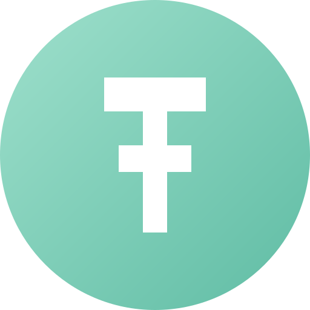

# USDTW — USDT Whale 🐋

**Fixed-supply, dollar-pegged token. $1 today, $1 tomorrow.**

USDTW is a digital dollar built for cross-border transfers on Solana, TRON and Polygon — fixed supply, no inflation, peg maintained at $1.00 by protocol-owned liquidity.

## Official contract addresses

| Chain | Mint / Contract |
|---|---|
| **Solana** | `AFNnpqWGngEe8FUrwcc7kPb2ooXZP9u6dzbfehBnoBT` (SPL, 6 decimals) |
| **TRON** | `TEXzwNmm6n29QcZVjhZZ6FU7wT53PbXnT8` (TRC-20, 6 decimals) |
| **Polygon** | `0xcAD10FD6004EE3cA63bEa76AbD40a31A3cafE443` (ERC-20, 6 decimals, immutable — LP burned to 0xdead) |

⚠️ Always verify the mint address above. USDTW is delivered to self-custody wallets only.

## Token facts

- **Total supply:** 79,990,000 USDTW — fixed forever, no mint function on Polygon, treasury-guarded on Solana/TRON
- **Peg:** $1.00, maintained by protocol-owned liquidity (Solana pool AZ1kiKGt…, ~$11.9M depth)
- **Use:** dollar substitute for cheap, fast cross-border value transfer — not an investment vehicle, no yield promises
- **Website / claims:** https://afritz77.github.io/usdtw-claims/

## Rewards program

Holders of USDT Whale Rewards (USDTW+) can claim tokens + SOL bonus at the official portal: https://afritz77.github.io/usdtw-claims/

## Contact

Official channel opens with listings. Watch this repo for announcements.
